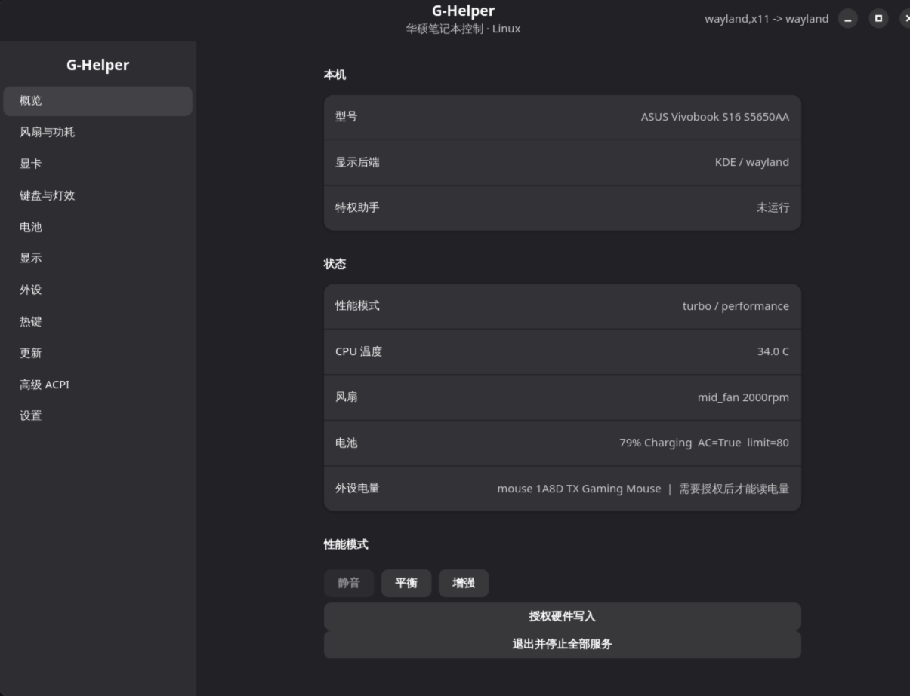

# G-Helper for Linux

[简体中文](#简体中文) · [English](#english)

Wayland-first ASUS laptop control for Linux, with an X11 fallback.

This is a community Linux port based on [seerge/g-helper](https://github.com/seerge/g-helper), maintained in [xiaohuangbo/g-helper-for-Linux](https://github.com/xiaohuangbo/g-helper-for-Linux). It is not an official ASUS application or an official Linux release of upstream G-Helper.



## 简体中文

### 项目简介

G-Helper for Linux 是面向华硕笔记本的硬件控制应用，使用 Python、GTK4 和 libadwaita。它优先使用原生 Wayland，并保留 X11 回退，提供主窗口和系统托盘。

本项目复用上游 G-Helper 的硬件协议研究与 ACPI 设备号，在 Linux 上通过内核 sysfs、固件属性和 hidraw 接口实现相应控制。它是用户空间控制工具，本身不替代 Linux 内核驱动。上游 Windows 源码和历史保留在本仓库中，Linux 实现位于 [linux/](linux/)。

### 功能与支持范围

| 功能 | 当前状态 |
| --- | --- |
| Wayland / X11 | Wayland 优先；可显式选择 X11 |
| 主窗口与托盘 | 托盘右键只有「打开主窗口」「停止服务并退出」 |
| 性能模式 | 静音、平衡、增强；根据内核暴露的能力启用 |
| 硬件状态 | CPU 温度、风扇转速、电池状态和充电上限 |
| 电池与背光 | 充电上限、键盘背光亮度、屏幕亮度 |
| 外设电量 | 后台轮询，在概览、外设页和托盘提示中显示；实测 TX Gaming Mouse |
| 鼠标设置 | 电量、DPI、轮询率等协议接口；不同型号仍需验证 |
| 风扇曲线 | 需要内核 hwmon 暴露对应的 pwm auto-point 节点 |
| 显卡模式 | 实现 Eco / Standard / Ultimate / Optimized 控制路径，依赖硬件、内核与驱动 |
| 显示刷新率 | 以 KDE 的 kscreen-doctor 为主，包含 wlr-randr / swaymsg 回退路径 |
| 电源自动化 | 插电 / 电池性能模式切换、刷新率切换 |
| Fn 热键 | 监听 Asus WMI hotkeys 输入设备，依赖设备访问权限 |
| 固件与高级控制 | asus-armoury 属性发现、ACPI 标量接口、BIOS / fwupd 查询入口 |

**支持按实际能力检测，不代表与 Windows 版全功能等价。** 型号目录中存在某个设备不等于所有设置都已完成实机验证。

### 环境与依赖

- Linux，Python 3.11+，GTK4、libadwaita、PyGObject、dbus-python。界面使用较新的 libadwaita 控件，建议 libadwaita 1.4+。
- polkit：需要提升权限时由桌面认证代理显示授权对话框。
- 兼容的内核 ASUS 驱动，例如 asus-nb-wmi / asus-wmi；部分能力需要 asus-armoury。
- KDE Plasma 原生支持 StatusNotifier 托盘；GNOME 通常需要 AppIndicator 扩展。
- 可选工具：kscreen-doctor、wlr-randr、swaymsg、nvidia-smi、fwupdmgr。

Arch / CatOS 依赖示例：

```bash
sudo pacman -S --needed python python-gobject python-dbus gtk4 libadwaita polkit
```

其他发行版请安装对应的软件包。旧版发行版提供的 GTK / libadwaita 可能不满足界面要求。

### 从源码运行

```bash
git clone https://github.com/xiaohuangbo/g-helper-for-Linux.git
cd g-helper-for-Linux
python3 linux/bin/ghelper
```

常用命令：

```bash
# 只读硬件状态，不打开窗口
python3 linux/bin/ghelper status

# 指定显示后端
python3 linux/bin/ghelper --backend wayland
python3 linux/bin/ghelper --backend x11

# 启动到托盘
python3 linux/bin/ghelper --minimized

# 列出识别到的 ASUS 外设
python3 linux/bin/ghelper devices
```

左键单击托盘图标可切换窗口显示。关闭窗口时，若托盘可用，应用继续在后台运行；要退出，请使用「停止服务并退出」。

### 硬件授权与退出

GUI 以普通用户运行。读取受限 HID 设备或写入硬件设置可能需要授权：点击「授权硬件写入」会通过 pkexec 启动 root 助手，可能出现系统密码对话框。请勿将整个 GUI 以 root 启动。

安装后，也可以启用助手服务：

```bash
sudo systemctl enable --now ghelper-helper.service
```

「停止服务并退出」会停止应用的轮询与监听、释放托盘和窗口，并请求助手退出。此操作针对 G-Helper 的组件，不会停止系统的 asusd 等其他服务。

当前 root 助手仍需安全加固：socket 使用较宽的本地权限，不能将它视为成熟的多用户授权边界。建议先在个人开发机器测试；多用户环境部署前应审查 [助手实现](linux/ghelper/helper.py) 和 [写入白名单](linux/ghelper/hw/whitelist.py)。

### 构建安装包

```bash
cd linux
make test
make packages
```

需要 make、GNU install 和 zstd。当前构建脚本生成：

- linux/dist/ghelper_0.292.0-3_all.deb
- linux/dist/ghelper-0.292.0-3.noarch.rpm
- linux/dist/ghelper-0.292.0-3-any.pkg.tar.zst

例如，在 Arch / CatOS 上安装本地构建产物：

```bash
sudo pacman -U dist/ghelper-0.292.0-3-any.pkg.tar.zst
```

Nix 构建描述位于 [default.nix](linux/default.nix) 和 [flake.nix](linux/flake.nix)。Nix 是构建表达式，不是上述安装包形式；该路径目前尚未经过本机完整构建验证。deb / rpm 已有生成脚本，但仍需相应发行版的安装、依赖和卸载验证。

构建产物默认不提交到 Git，建议通过本仓库的 [GitHub Releases](https://github.com/xiaohuangbo/g-helper-for-Linux/releases) 发布。

### 已知限制与测试

- 已有实机冒烟范围：CatOS / KDE Plasma，Wayland 和 X11，Vivobook S16 S5650AA，TX Gaming Mouse。其他型号欢迎反馈。
- 本机仅暴露 balanced / performance，且没有可编程风扇曲线节点；不会凭空增加静音档或曲线写入能力。
- 内核 lockdown 会阻止 debugfs ACPI 访问；界面会提示状态并禁用高级 ACPI 控件。不要为此关闭系统安全机制。
- Anime Matrix、Slash 动画、逐键 Aura、Windows NvAPI / PawnIO / Ryzen SMU 功能尚未完整移植。
- 性能叠加层、其他合成器的刷新率路径、键盘 / 耳机电量协议和 BIOS 查询仍需进一步兼容性验证。
- 内核属性、GPU 切换语义和重启要求可能随型号及内核变化；请先确认机型支持，再更改高级设置。

```bash
cd linux
make test
python3 bin/ghelper --self-test
```

图形测试需要有效的桌面会话。另有 [GUI 冒烟脚本](linux/tests/gui_smoke.py)，目前含开发机的设备和电量断言，换机器运行前需要调整。

报告问题请附：发行版、内核版本、桌面与显示后端、笔记本型号、外设 VID/PID、复现步骤和相关日志；请隐去序列号及其他个人信息。

## English

### About

G-Helper for Linux is a user-space ASUS laptop control application built with Python, GTK4 and libadwaita. It prefers native Wayland, keeps an X11 fallback, and provides a main window and a StatusNotifier tray icon.

The port builds on upstream G-Helper hardware research and ACPI device IDs, using Linux sysfs, firmware attributes and hidraw. It does not replace kernel drivers. The upstream Windows sources and history are retained; the Linux implementation lives in [linux/](linux/).

### Features and scope

| Feature | Current status |
| --- | --- |
| Wayland / X11 | Wayland first; explicit backend selection |
| Window and tray | Context menu: Open window; Stop services and quit |
| Performance profiles | Silent, Balanced and Turbo, enabled according to kernel capabilities |
| Monitoring | CPU temperature, fan speeds, laptop battery and charge limit |
| Battery and brightness | Charge limit, keyboard backlight and display brightness |
| Peripheral battery | Background polling; shown in the window and tray tooltip; TX Gaming Mouse tested |
| Mouse controls | Battery, DPI and polling-rate protocol interfaces; model-specific validation needed |
| Fan curves | Requires corresponding hwmon pwm auto-point nodes |
| GPU modes | Eco / Standard / Ultimate / Optimized code paths; hardware and driver dependent |
| Refresh rate | Primarily KDE kscreen-doctor, with wlr-randr / swaymsg fallback paths |
| Automation | AC/battery profile and refresh-rate switching |
| Fn keys | Asus WMI hotkeys input listener, subject to permissions |
| Advanced controls | asus-armoury attribute discovery, scalar ACPI interfaces, BIOS / fwupd query entry points |

**This is an experimental port, not full Windows feature parity.** A device entry in the catalog does not guarantee that every control has been tested on that model.

### Requirements and quick start

Linux, Python 3.11+, GTK4, libadwaita, PyGObject, dbus-python and polkit are required. libadwaita 1.4+ is recommended for the widgets used by this UI. Hardware functions require compatible ASUS kernel drivers such as asus-nb-wmi / asus-wmi; some require asus-armoury. KDE Plasma supports the tray natively; GNOME generally needs an AppIndicator extension.

Arch / CatOS example:

```bash
sudo pacman -S --needed python python-gobject python-dbus gtk4 libadwaita polkit
git clone https://github.com/xiaohuangbo/g-helper-for-Linux.git
cd g-helper-for-Linux
python3 linux/bin/ghelper
```

```bash
python3 linux/bin/ghelper status          # Read-only hardware snapshot
python3 linux/bin/ghelper devices         # ASUS peripheral discovery
python3 linux/bin/ghelper --backend wayland
python3 linux/bin/ghelper --backend x11
python3 linux/bin/ghelper --minimized
```

Optional tools include kscreen-doctor, wlr-randr, swaymsg, nvidia-smi and fwupdmgr. Package names differ across distributions; older GTK / libadwaita releases may not meet the UI requirements.

### Authorization and shutdown

Run the GUI as your regular user. The Authorize hardware writes button launches the privileged helper through pkexec and may trigger a system password dialog. Restricted HID access and hardware writes may require this helper. After installation it can also be started with:

```bash
sudo systemctl enable --now ghelper-helper.service
```

Closing the window keeps the application running when a tray is available. Use **Stop services and quit** to stop polling and listeners, release the tray/window, and request helper shutdown. This only targets G-Helper components, not unrelated services such as asusd.

The root helper still needs security hardening: its local socket permissions are broad and should not be treated as a production multi-user authorization boundary. Review the [helper](linux/ghelper/helper.py) and [write allow-list](linux/ghelper/hw/whitelist.py) before deploying on shared systems.

### Build and packaging

```bash
cd linux
make test
make packages
```

The build requires make, GNU install and zstd. Current outputs:

- linux/dist/ghelper_0.292.0-3_all.deb
- linux/dist/ghelper-0.292.0-3.noarch.rpm
- linux/dist/ghelper-0.292.0-3-any.pkg.tar.zst

Install a local Arch / CatOS build with:

```bash
sudo pacman -U dist/ghelper-0.292.0-3-any.pkg.tar.zst
```

[Nix expressions](linux/default.nix) and a [flake](linux/flake.nix) are provided, but have not yet been fully built and validated locally. Nix uses build expressions rather than a package file equivalent to the other formats. Generated deb / rpm packages still need installation, dependency and removal testing on their target distributions.

Build outputs are ignored by Git. Distribute them through [GitHub Releases](https://github.com/xiaohuangbo/g-helper-for-Linux/releases).

### Known limits and validation

- Hardware smoke tests so far cover CatOS / KDE Plasma on Wayland and X11, a Vivobook S16 S5650AA, and a TX Gaming Mouse. Other hardware needs testing.
- The development laptop exposes only balanced / performance and no programmable fan-curve nodes. Unsupported controls cannot be enabled by the application alone.
- Kernel lockdown blocks debugfs ACPI access. The UI reports lockdown and disables advanced ACPI controls. Do not disable system security just for this feature.
- Anime Matrix, Slash animation, per-key Aura and Windows NvAPI / PawnIO / Ryzen SMU features are not fully ported.
- The metrics overlay, refresh control on other compositors, keyboard/headset battery protocols and BIOS queries need further compatibility work.
- Firmware attributes and GPU switching semantics may vary by model and kernel, including reboot requirements.

```bash
cd linux
make test
python3 bin/ghelper --self-test
```

GUI tests require a working desktop session. The additional [GUI smoke script](linux/tests/gui_smoke.py) currently includes development-machine-specific device and battery assertions; adapt it before testing another system.

For bug reports, include distribution/kernel versions, desktop/backend, laptop model, peripheral VID/PID, reproduction steps and relevant logs. Remove serial numbers and personal information.

## Project layout / 项目结构

| Path | Purpose / 用途 |
| --- | --- |
| [linux/ghelper/](linux/ghelper/) | Linux application / Linux 应用 |
| [linux/ghelper/ui/](linux/ghelper/ui/) | GTK main window / 主窗口 |
| [linux/ghelper/hw/](linux/ghelper/hw/) | Hardware backends / 硬件接口 |
| [linux/ghelper/peripherals/](linux/ghelper/peripherals/) | Peripheral protocols / 外设协议 |
| [linux/packaging/](linux/packaging/) | Packaging scripts and recipes / 打包脚本 |
| [linux/share/](linux/share/) | Desktop, polkit, udev, systemd integration / 系统集成 |
| [linux/tests/](linux/tests/) | Tests / 测试 |
| [app/](app/) | Upstream Windows sources / 上游 Windows 源码 |
| [docs/](docs/) | Upstream documentation / 上游文档 |

## Contributing / 参与贡献

Issues and pull requests are welcome: hardware compatibility reports, protocol validation, desktop integration, packaging fixes, translations and security hardening. Keep hardware protocols separate from the UI and add tests for protocol parsing where possible.

欢迎提交 Issue 和 PR：机型兼容报告、协议验证、桌面集成、打包修复、翻译和权限加固。请保持硬件协议与界面分离，并尽量为协议解析补充测试。

## Credits and license / 致谢与许可证

Thanks to [seerge/g-helper](https://github.com/seerge/g-helper) and its contributors for the original G-Helper application and hardware protocol research, and to the Linux ASUS driver and desktop communities. This repository retains the upstream [LICENSE](LICENSE), copyright notices and source history. Linux additions follow the same GPLv3 license.

感谢上游 G-Helper 及其贡献者提供的原始应用与硬件协议研究，也感谢 Linux ASUS 驱动和桌面社区。本仓库保留上游许可证、版权声明与源码历史；Linux 新增代码沿用 GPLv3。
